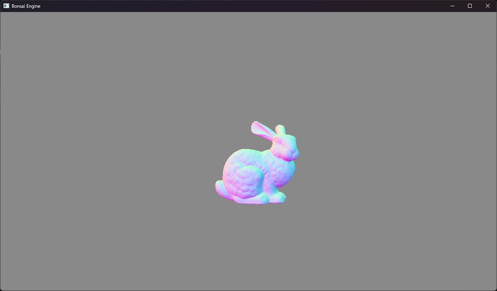

# Bonsai Engine

[](https://github.com/nemjit001/bonsai-engine/actions/workflows/ci_build_and_test.yaml)

A C++17 render engine that implements a modern forward+ PBR render pipeline.

## AI Notice

No generative AI (LLM's, code assistants, etc.) has been used during the development of Bonsai, since Bonsai is a learning/self-study project.
If/when that changes, this AI notice will be updated, until that time you can be sure that Bonsai remains entirely handwritten.

## How to build Bonsai

Bonsai requires CMake 3.28^ and VCPKG to build. All dependencies are provided with Bonsai.

To configure the project run:
```$ cmake . --preset <preset name>```

To build the project run:
```$ cmake --build --preset <build preset name>```

## Preview



## License

Bonsai is licensed under the MIT license.
